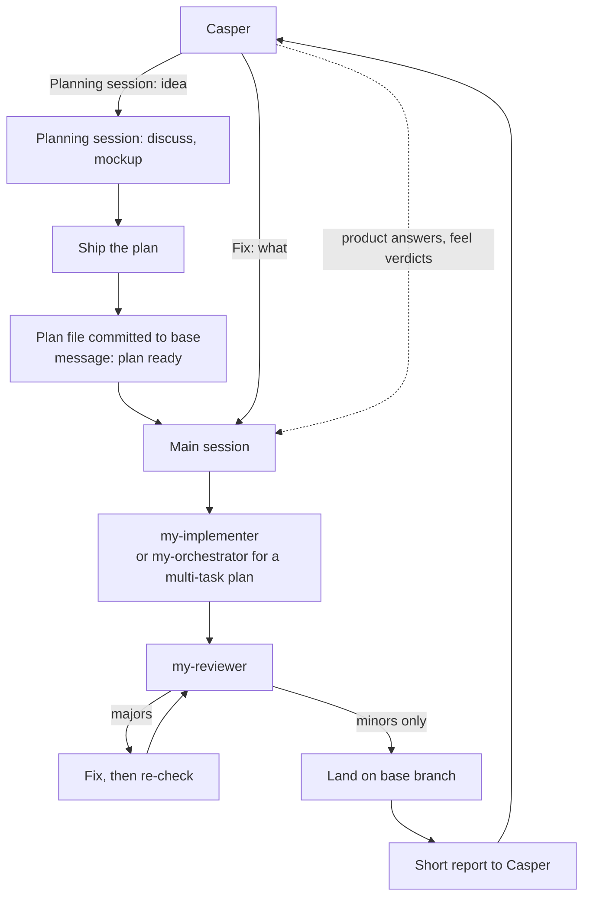

# How I use the Claude workflow

A guide for me. The rules themselves are in `CLAUDE.md`, the skills and the agents; this
only shows how they fit.

## Setup

One **main session** per project builds. Its title is the contract's `Main session:` line,
so other sessions can find it. Any number of **planning sessions** run beside it: they
discuss a feature, may read code and mock it up, and never write app code. The main session
decides and delegates to agents: `my-implementer` for one task, `my-reviewer` to review
it, `my-scout` for lookups and gate runs, `my-orchestrator` only for a plan with several
tasks. Main talks to me about product questions only.

## Flow

## What I type

| Prompt | What happens |
|---|---|
| `Planning session: <idea>` | Not a keyword. I open a new session and say this; it follows the Planning sessions rules in `CLAUDE.md`. |
| `Ship the plan` | The planning session writes `docs/plans/<feature>.md`, commits it to the base branch, and messages the main session "plan ready: <path>". |
| `Fix: <what>` | Not a keyword. A small fix asked directly of the main session; it goes to an implementer with no planning session. |
| `continue` | Not a trigger in this repo. A project's contract or tracker may define it. In a fresh main session, titled exactly as the contract says (after archiving the old one), main reads the project's tracker and plans folder (a plan still there is not yet implemented) and resumes. |
| `audit` | Triggers `my-repo-audit` when I ask for an audit or health check. Plan and decisions only, no code. |
| `retro` | Triggers `my-retro` (also "why was that slow or expensive"). Gives an HTML page from the transcripts. |
| `go over open items` | Triggers `my-open-items` (also `/my-open-items`, "what needs me"). One question at a time. |

Other skills fire on their own descriptions: `my-feature-flow` (starting a change), `my-pr-review`
(reviews), `my-decision-log` (a settled decision), `my-consistency-sweep` (on request).

## What lives where

| Dotfiles (generic, this repo) | Project repo |
|---|---|
| Roles and rules: `claude/CLAUDE.md` | The `## Workflow contract` in its `CLAUDE.md` |
| Skills `my-*` and agents `my-*` | Gate and land scripts, git hooks |
| Retro tools: `claude/tools/retro` | Plans, tracker or status file |
| Contract template: `claude/contract-template.md` | Decisions log, review rubric |

Nothing project-specific goes in dotfiles. A project without a contract is treated as
`mature`.

## Rules of thumb

- Only one main session per project builds; planning sessions never write app code.
- At most the contract's number of features in flight (default 2); landings go one at a time.
- Main does no hands-on work: it hands paths and tasks to agents.
- Ask me only product questions and lasting choices, batched, with a recommendation.
- Motion and feel are my call on the contract's `Preview`; the work waits for my verdict.
- Every commit goes through the hooks. Nothing is pushed or merged unless I ask or the
  contract's merge policy says so.
- Settled decisions go in the project's decisions log, one line each.
