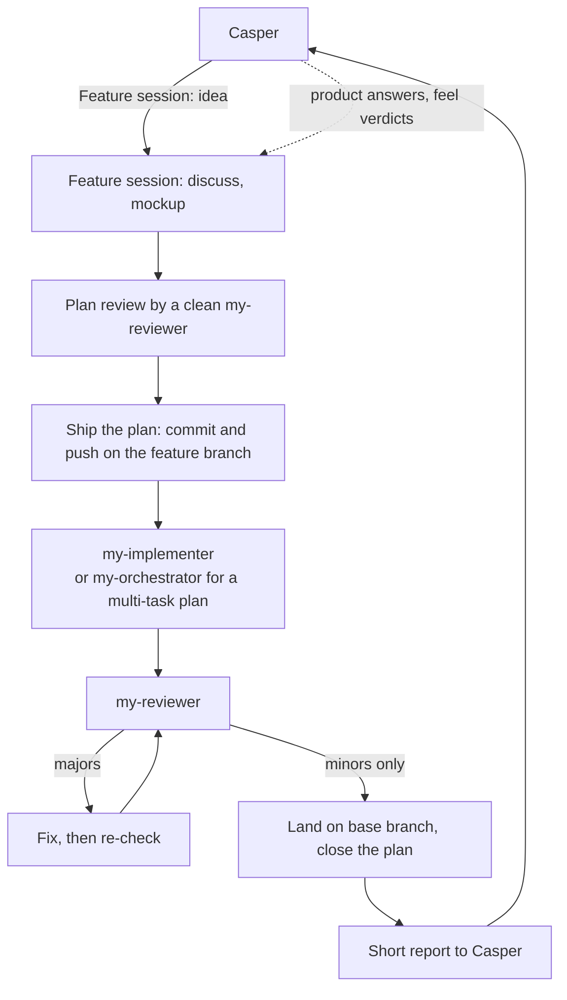

# How I use the Claude workflow

A guide for me. The rules themselves are in `CLAUDE.md`, the skills and the agents; this
only shows how they fit.

## Setup

One Opus **feature session** per feature (I run 1 to 2 at once). It discusses the feature
with me, may read code and mock it up, gets a plan review, ships the plan, then starts the
agents itself: `my-implementer` for one task, `my-reviewer` to review it, `my-scout` for
lookups and gate runs, `my-orchestrator` only for a plan with several tasks. It answers their
questions with me and closes the plan. It talks to me about product questions only.

## Flow

## What I type

| Prompt | What happens |
|---|---|
| `Feature session: <idea>` | Not a keyword. I open a new session and say this; it follows the Feature sessions rules in `CLAUDE.md`. |
| `Ship the plan` | The session writes `docs/plans/<feature>.md`, commits and pushes it on the feature branch, then starts the agents itself. |
| `Fix: <what>` | Not a keyword. A small fix asked directly of a session; it goes to an implementer with no plan. |
| `continue` | Not a trigger in this repo. A project's contract or tracker may define it. A session that is told to continue reads the project's tracker and plans folder (a plan still there is not yet implemented) and resumes. |
| `audit` | Triggers `my-repo-audit` when I ask for an audit or health check. Plan and decisions only, no code. |
| `retro` | Triggers `my-retro` (also "why was that slow or expensive"). Gives an HTML page from the transcripts. |
| `go over open items` | Triggers `my-open-items` (also `/my-open-items`, "what needs me"). One question at a time. |

Other skills fire on their own descriptions: `my-feature-flow` (starting a change), `my-review`
(reviews), `my-decision-log` (a settled decision), `my-consistency-sweep` (on request), `my-worktree-cleanup` (stale worktrees: list, then remove the ones I approve).
`my-workspace-setup` (new account, missing connector, trimming startup context) lists what to connect
and what to turn off. `claude/scripts/tool-usage.py` counts MCP and skill calls over the last N days.

## What lives where

| Dotfiles (generic, this repo) | Project repo |
|---|---|
| Roles and rules: `claude/CLAUDE.md`; feature-session rules: `claude/output-styles/main-thread.md` | The `## Workflow contract` in its `CLAUDE.md` |
| Skills `my-*` and agents `my-*` | Gate and land scripts, git hooks |
| Retro tools: `claude/tools/retro` | Plans, tracker or status file |
| Contract template: `claude/contract-template.md` | Decisions log, review rubric |
| Run cap: `claude/tools/heavy-slot` (2 heavy runs machine-wide) | Justfile calls to it |
| Hook: `claude/tools/wait-loop-hook.py` (logs waiting loops, log only) | |

Nothing project-specific goes in dotfiles. A project without a contract is treated as
`mature`.

## Rules of thumb

- One feature session per feature; it never writes app code itself.
- At most the contract's number of features in flight (default 2); a landing that finds the base moved is rerun.
- The session does no hands-on work: it hands paths and tasks to agents.
- Ask me only product questions and lasting choices, batched, with a recommendation.
- Motion and feel are my call on the contract's `Preview`; the work waits for my verdict.
- Every commit goes through the hooks. Nothing is pushed or merged unless I ask or the
  contract's merge policy says so.
- Settled decisions go in the project's decisions log, one line each.
